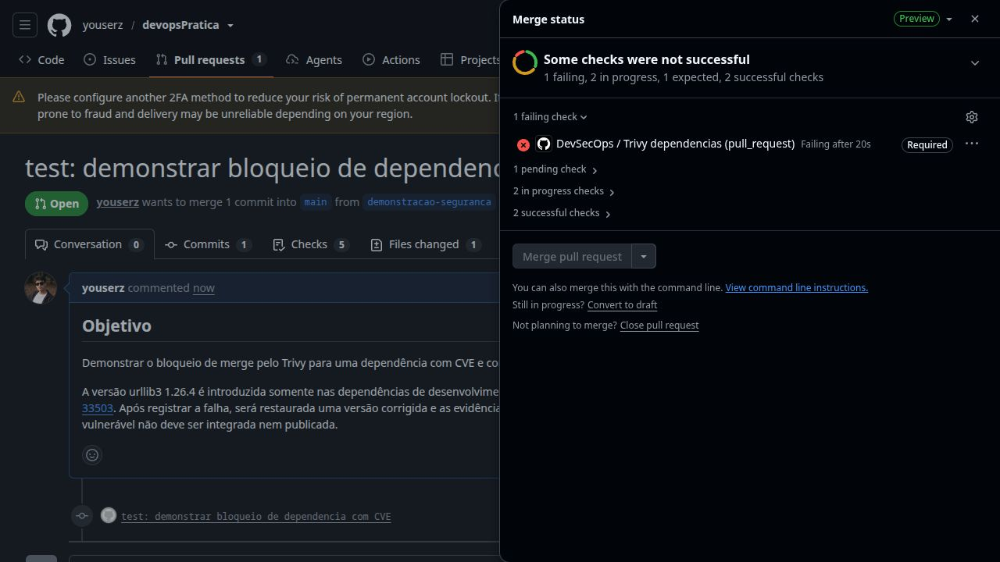
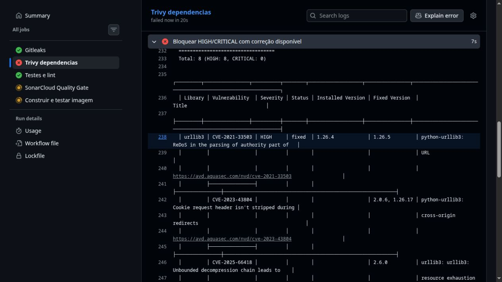
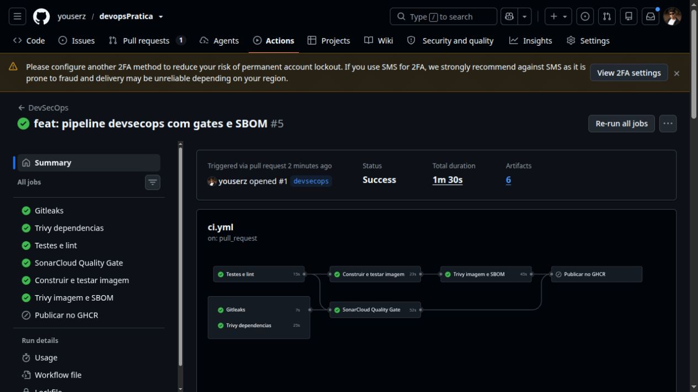
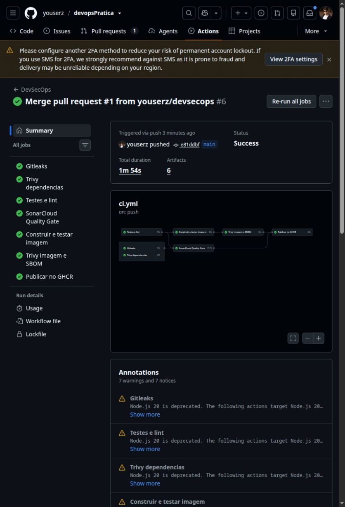
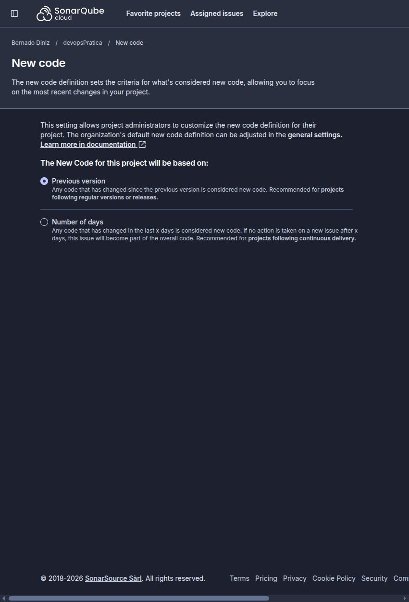
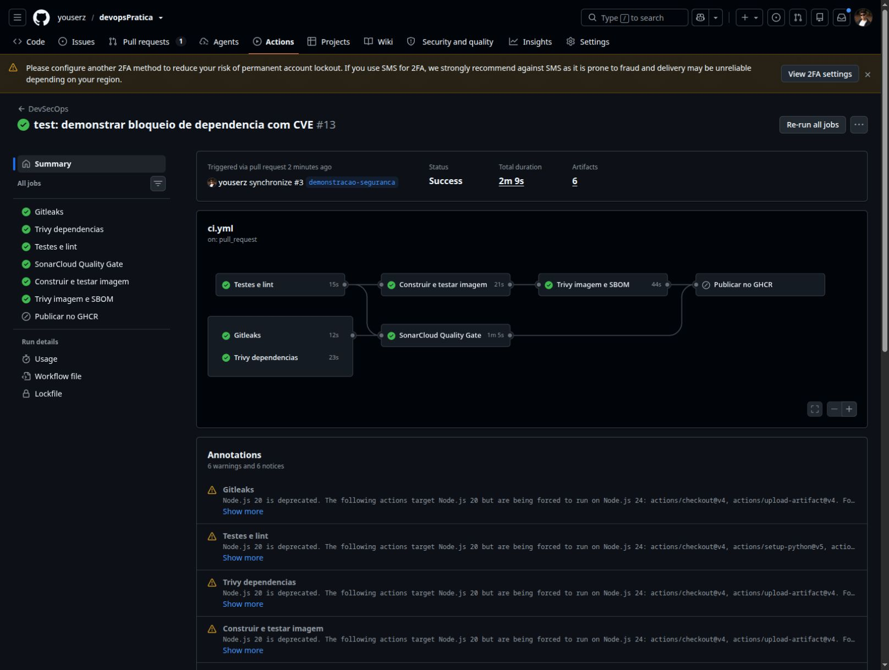
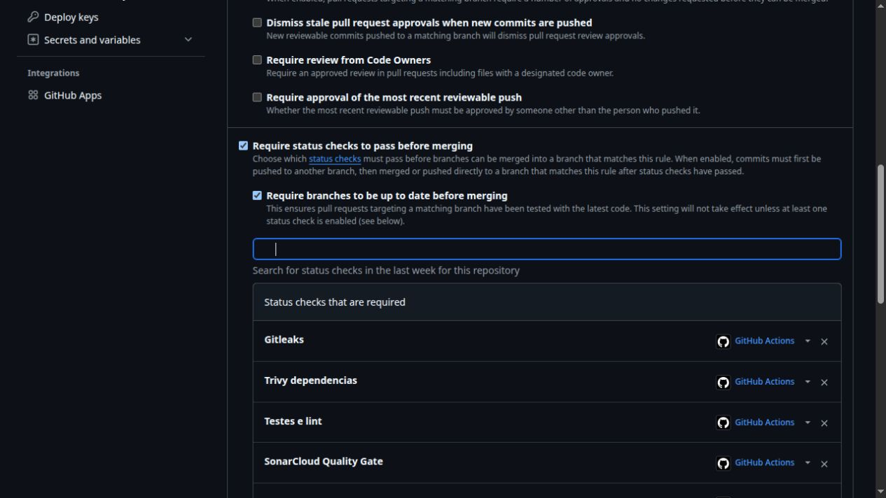

# Evidências do trabalho DevSecOps

Data: 27/10/2026 (America/Sao_Paulo).

## Repositório e implementação

- [Repositório](https://github.com/youserz/devopsPratica).
- [Workflow YAML](https://github.com/youserz/devopsPratica/blob/main/.github/workflows/ci.yml).
- [Primeira execução](https://github.com/youserz/devopsPratica/actions/runs/40595101752).
- [Execução da main com publicação no GHCR](https://github.com/youserz/devopsPratica/actions/runs/40595459804).
- Projeto SonarCloud: [youserz_devopsPratica](https://sonarcloud.io/summary/new_code?id=youserz_devopsPratica).

## Bloqueio de vulnerabilidade corrigível

[PR #3](https://github.com/youserz/devopsPratica/pull/3), branch `demonstracao-seguranca`.

A versão `urllib3==1.26.4` foi introduzida apenas nas dependências de desenvolvimento.
A CVE-2021-33503 tem severidade HIGH e correção em 1.26.5, conforme o
[advisory oficial](https://github.com/advisories/GHSA-q2q7-5pp4-w6pg).
O relatório encontrou também outras vulnerabilidades HIGH nessa versão antiga.
A correção usa 2.8.0, evitando restaurar apenas a correção mínima de uma CVE.

- Commit vulnerável: `276743f6061b881e53bee8e3a59321e35a1602d0`.
- [Execução reprovada](https://github.com/youserz/devopsPratica/actions/runs/40608578318).
- [Log Trivy](https://github.com/youserz/devopsPratica/actions/runs/40608578318/job/122554182342).

Trecho real da execução:

```text
development/requirements.txt (pip)
Total: 8 (HIGH: 8, CRITICAL: 0)
Library  Vulnerability   Severity  Status  Installed Version  Fixed Version
urllib3  CVE-2021-33503  HIGH      fixed   1.26.4             1.26.5
Error: Process completed with exit code 1.
```





A primeira tentativa mostrou que `requirements-dev.txt` não era reconhecido na
varredura padrão. O workflow foi corrigido para preparar manifests reconhecidos
para execução e desenvolvimento. A execução acima comprova essa cobertura;
os critérios HIGH/CRITICAL e `ignore-unfixed` foram preservados.

## Publicação e SBOM

A publicação ocorre somente em pushes aprovados na main, usando a mesma imagem
transferida entre jobs. Na execução da main acima, todos os gates e o job
`Publicar no GHCR` concluíram com sucesso. Imagem publicada:

```text
ghcr.io/youserz/devopspratica:sha-e81ddbfd66b37b00dcb2ef662abab7fe866af905
```

Os PRs não publicam imagens. O commit vulnerável permaneceu fora da main.

O Syft gerou o artifact `sbom-spdx` (SPDX JSON), com componentes e versões.
Ele pode ser baixado na seção Artifacts da execução:
[SBOM e relatórios](https://github.com/youserz/devopsPratica/actions/runs/40595459804#artifacts).





## Proteção e Quality Gate

A main exige PR, branch atualizada e os seis checks: Gitleaks, Trivy dependencias,
Testes e lint, SonarCloud Quality Gate, Construir e testar imagem e Trivy imagem e SBOM.
A regra também se aplica ao administrador; force push e exclusão não são permitidos.

O SonarCloud usa análise via CI, o gate Sonar way e código novo baseado em
Previous version. Nos PRs, a análise avalia as alterações em relação à branch base.
O scanner aguarda o Quality Gate e retorna falha se ele reprovar.



## Validação local

- Ruff aprovado.
- 3 testes pytest aprovados; cobertura de app: 100%.
- Actionlint aprovado.
- Imagem Python 3.12 Alpine construída com sucesso.
- Histórico completo analisado por Gitleaks sem vazamentos encontrados.

## Aprovação após corrigir a dependência

A dependência foi restaurada para `urllib3==2.8.0` no mesmo PR #3.
As execuções e artifacts estão disponíveis na aba Checks do PR.

- Commit corrigido: `8c28aa5`.
- [Execução aprovada](https://github.com/youserz/devopsPratica/actions/runs/40608680824).
- [Trivy dependências aprovado](https://github.com/youserz/devopsPratica/actions/runs/40608680824/job/122554759762).
- [SBOM e relatórios](https://github.com/youserz/devopsPratica/actions/runs/40608680824#artifacts).

Os seis checks obrigatórios foram aprovados. A publicação foi ignorada por ser PR.




